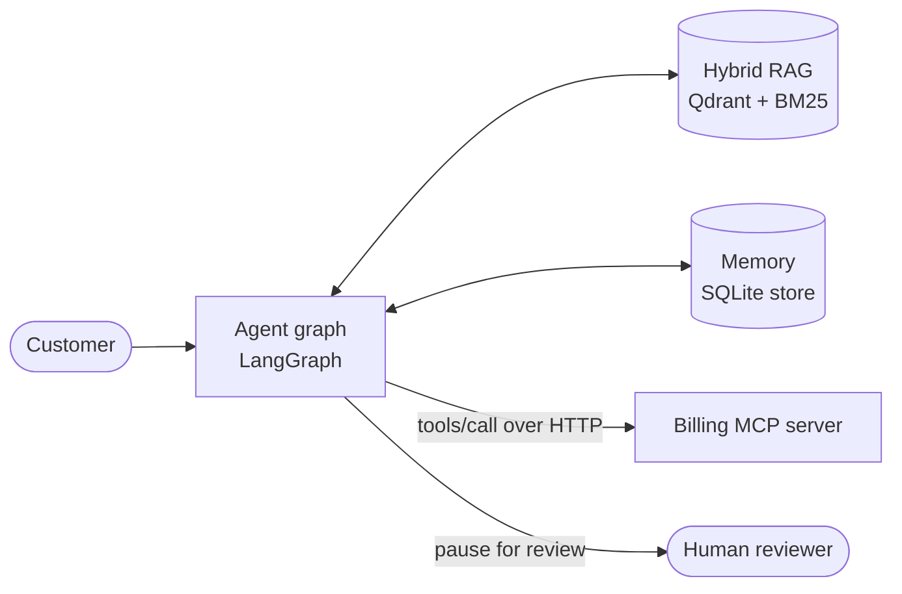
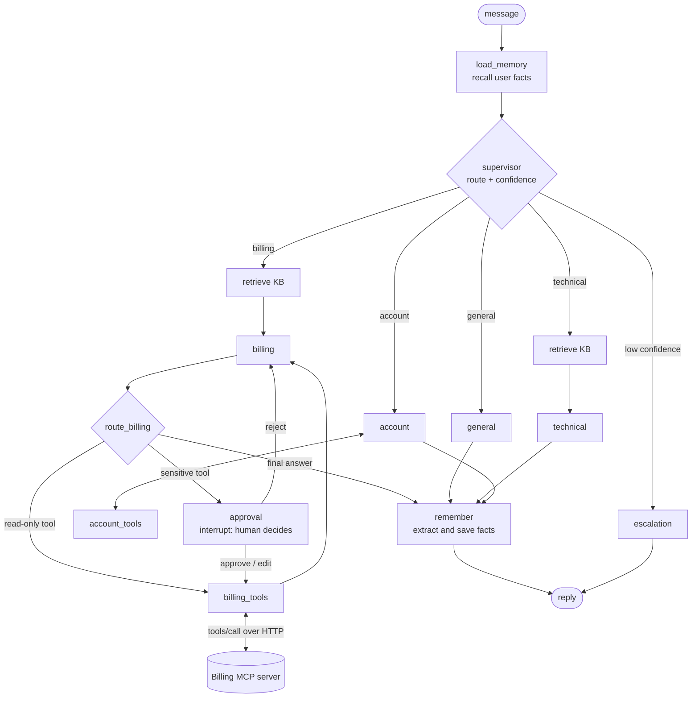
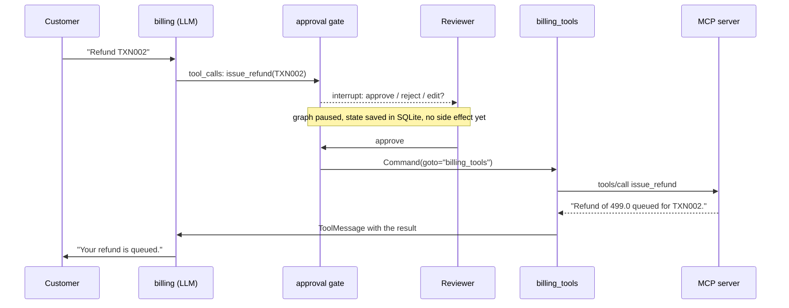
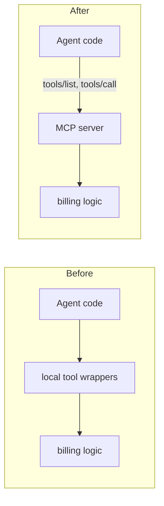

# Support Agent Lab

A multi-agent customer-support system built with **LangGraph**,
A supervisor routes each message to a specialist agent; specialists
use **hybrid RAG**, **long-term memory**, and **tools served over MCP**; refunds pause for a
**human approval gate** before any money moves.



## What it can do

| Capability | How it works |
|---|---|
| **Routing** | A supervisor LLM classifies each message (structured output) into `general`, `technical`, `billing` or `account`, with a confidence score. Low confidence escalates to a human. |
| **Hybrid RAG** | Technical and billing answers are grounded in a knowledge base: dense vectors (Qdrant + Ollama embeddings) fused with BM25 via weighted Reciprocal Rank Fusion, filtered by category, cited as `[KB-XXX-00]`. |
| **Long-term memory** | After each reply an extractor saves durable facts (plan, device, preferences) per `user_id`. They are recalled in later conversations. Card numbers and secrets are never stored. |
| **MCP tools** | Billing tools (`check_payment_status`, `issue_refund`) live on a separate FastMCP server. The agent discovers them at startup with `tools/list`. There is no billing code in the agent. |
| **Human-in-the-loop** | Sensitive tool calls pause the graph (`interrupt`). A reviewer can approve, reject, or edit the amount. The pause survives a process restart because it lives in the checkpoint. |
| **Persistence** | SQLite checkpointer (per conversation thread) and SQLite store (per user, semantic search). |
| **Evals and tests** | A 40-row labeled eval set with code graders (routing, escalation, RAG recall, grounding) plus a pytest suite. No LLM is needed for the unit tests. |

## Architecture



**Design rules**

- The model only *requests* a tool call. Plain Python (`route_billing`) decides whether it needs approval, so the model cannot skip the gate.
- The tool list is the single source of truth: the same list is bound to the model and executed by the `ToolNode`.
- Agents without tools are never told about tools (this avoids `tool_use_failed`).
- `user_id` comes from trusted config, never from the model or the message text.

## Refund flow (HITL + MCP)



## Why MCP instead of hardcoded tools?



The agent no longer knows tool names, descriptions or schemas. It asks the server at startup.
Adding a tool on the server needs no agent change, and any other MCP client can reuse the same server.
If the server is unreachable at startup, billing runs in a **degraded mode** with no tools and a
prompt that forbids claiming any lookup or refund.

## Project structure

```
support-agent-lab/
├── app/
│   ├── graph.py          # LangGraph wiring (nodes, edges, checkpointer, store)
│   ├── nodes.py          # supervisor, specialists, retrieve, memory nodes
│   ├── approval.py       # human approval gate (interrupt / resume)
│   ├── tools.py          # account tool + SENSITIVE_TOOLS policy + MCP tool loading
│   ├── mcp_tools.py      # MCP client: discovery + sync wrappers
│   ├── prompts.py        # all prompts (specialists, context, memory, degraded mode)
│   ├── state.py          # graph state and structured-output schemas
│   ├── store.py          # long-term memory (SQLite store, semantic index)
│   ├── checkpoints.py    # SQLite checkpointer
│   ├── llm.py            # Groq model factory
│   └── rag/              # hybrid retriever, KB loader, knowledge base (markdown)
├── servers/
│   ├── billing_server.py # FastMCP server (HTTP, port 8765)
│   └── billing_logic.py  # payment lookup and refund rules (the "backend")
├── evals/                # labeled dataset, graders, runner
├── tests/                # pytest suite
├── scripts/              # demos and checks (HITL, memory, routing, retrieval, MCP client)
└── streamlit_app.py      # test console: chat, memory, review panel, debug view
```

## Quick start

Developed on Python 3.13. Requires a [Groq](https://console.groq.com) API key, and [Ollama](https://ollama.com).

```powershell
# 1. Install
python -m venv venv
.\venv\Scripts\Activate.ps1
pip install -r requirements.txt

# 2. Configure
Copy-Item .env.example .env        # then fill in GROQ_API_KEY (and BILLING_MCP_URL, see below)

# 3. Embeddings and knowledge base
ollama pull nomic-embed-text
python -m scripts.ingest_kb

# 4. Terminal 1: billing MCP server (run from the project root)
python -m servers.billing_server

# 5. Terminal 2: the app
streamlit run streamlit_app.py
```

`.env` needs `BILLING_MCP_URL=http://127.0.0.1:8765/mcp`. Start the server **before** the app:
tools are discovered once at startup, and the sidebar shows which billing tools were found.

**Try it:** ask *"I was charged twice. Please refund transaction TXN002."* The graph pauses and
the reviewer panel appears. Approve it and watch `TOOL CALL issue_refund(...)` appear in the
server terminal.

Test transaction IDs: `TXN001` (completed), `TXN002` (completed, course not activated),
`TXN003` (pending), `TXN004` (failed). Test account IDs: `ACC001` to `ACC003`.

## Tests and evals

```powershell
python -m pytest tests -q                 # unit tests, no LLM needed
python -m evals.run_evals                 # full labeled eval set (needs Groq, Ollama, MCP server)
python -m evals.run_evals rag-            # only rows whose id starts with "rag-"
```

Unit tests cover the approval gate (pause, approve, reject, edit, bad decisions), the billing
rules, the MCP server's tool schemas, the KB parser and the graders.

Other scripts: `scripts.demo_hitl` (pause and resume across separate processes),
`scripts.demo_memory`, `scripts.check_routing`, `scripts.check_retrieval`,
`scripts.check_mcp_client`, `scripts.chat_cli`.

## Tech stack

| Layer | Choice |
|---|---|
| Orchestration | LangGraph (StateGraph, checkpointer, store, `interrupt`) |
| LLM | Groq (`llama-3.3-70b-versatile`) via LangChain |
| Retrieval | Qdrant (local) + BM25, `EnsembleRetriever` (RRF), Ollama `nomic-embed-text` |
| Tools | FastMCP server (Streamable HTTP) + `langchain-mcp-adapters` |
| Persistence | SQLite (checkpoints and memory store with `sqlite-vec`) |
| Observability | LangSmith tracing |
| UI | Streamlit |

## Roadmap

| Module | Topic | Status |
|---|---|---|
| M0 to M8 | Setup, state, specialists, supervisor routing, escalation, tools, memory, tracing, evals | done |
| M9 | Hybrid RAG for technical and billing | done |
| M10 | Long-term memory | done |
| M11 | Human-in-the-loop approval | done |
| M12 | Tools behind an MCP server | done |

